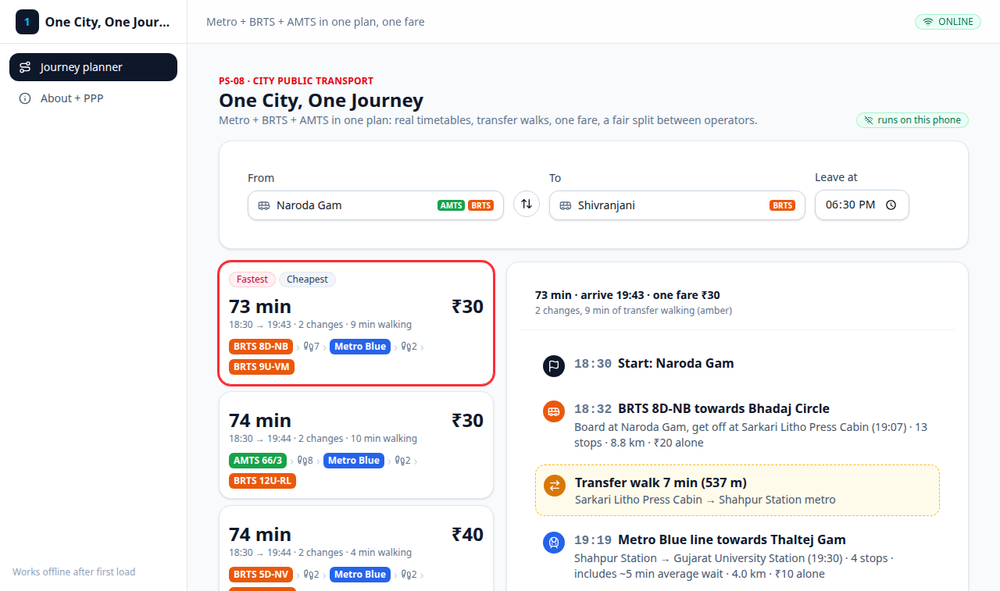

# One City, One Journey

**Metro Hacks (GDG Gandhinagar, 10 Oct 2026) · PS-08 "One City, One Journey" · City Public Transport track**

Made by **Rhythm Italiya** · ritaliya2003@gmail.com

Type where you start and where you are going, and get **one plan across Metro, BRTS and AMTS**: real bus times, every transfer walk, **one fare** (₹30 instead of ₹40 for three tickets) and a **fair split** for each operator. It works with **no internet**, even underground.



## The problem
From the brief: *"Metro, BRTS and city buses are run by different operators with separate tickets, and transfers between them are confusing."*

Ahmedabad has three transport systems (Metro by GMRC, BRTS by AJL, AMTS city buses), each with its own ticket and app. Nothing shows a trip that uses more than one. So a rider does not know which bus goes to the metro, how far to walk, or what the whole trip costs. Many people give up and use a bike or a car.

**Who it is for:**
- Daily riders who live or work far from a metro station (office workers, students, shop staff).
- The operators and the city. They win riders back, and the fair split shows what each operator gets from one ticket.

## What you can try
1. Click **"Try the sample trip"** (Naroda Gam → Shivranjani, 18:30). You get 3 options in under 0.1 seconds: 73 min ₹30, 74 min ₹30, 74 min ₹40.
2. Plan any trip between the 53 metro stations and about 3,000 AMTS/BRTS stops, at any time. You see the bus times, the walks (minutes and metres), the metro line and one fare.
3. Look at the fair split for each trip: what AMTS, the Metro and BRTS each get, plus a 2% fee.
4. Go offline: open the app once, turn on airplane mode, reload. It still plans trips.
5. Try a late trip: Thaltej Gam → Vastral Gam at 23:30. It says "No journey found", because the last metro has gone.

## Run it
You need Node.js 20.19 or newer.
```bash
git clone https://github.com/RhythmItaliya/One-City-One-Journey.git   # or unzip the zip
cd One-City-One-Journey
npm install
npm run dev          # open http://localhost:5173
```
**Offline test:** run `npm run build && npm run preview`, open the page once, turn off Wi-Fi and reload.

## Figma
- **Prototype (same as the app):** https://www.figma.com/design/wUFmSxo7M7PP4JNWRq3zzD?node-id=19-2. Press Present (▶) to click through the 6 screens. They are also in `figma/prototype.pdf` and `screens/figma/`.
- **First concept deck (older):** https://www.figma.com/design/u4yHDk2MyfrMaMNrn98ZEo/Metro-Hacks-%E2%80%93-PS-08-One-City--One-Journey?node-id=0-1. Its example trip and fare-split rule are different from the app.

## How it works
- **Data on the phone (about 1 MB):** the public AMTS + BRTS timetables (about 14,000 trips) and the 4 metro lines (53 stations).
- **Planner:** it finds the next real bus to a metro station, the best metro route, the next bus after it and the walks in between.
- **Fair split:** each operator keeps the fare for its own part. The rider gets ₹5 off per change, and each operator gives up a share of that by km. 2% goes to the ticket company.

## AI we used
- **There is no AI inside the app.** It is a normal search algorithm, so it is fast, works offline and always gives the same answer.
- **We built it with AI:** Claude Code (Claude Opus 5.5) wrote the code and the docs. A Claude agent with the Figma MCP made the Figma screens. We checked the work by running the app.
- **Main prompts (short):**
  1. Before the event: "Collect the public bus and metro data, and make an offline data pack and an offline app shell."
  2. On the train: "Read the brief, pick a problem and build it, ready to submit, with a Figma prototype." The result was PS-08.
  3. The Figma agent: "Make 6 clickable screens with the real sample-trip numbers, and check every screen."
  4. "Make a clean submission: the app, a simple README and ABOUT, the prompts and the skill files."
- **Skill files:**
  - `.claude/skills/one-journey/SKILL.md`: how the planner works.
  - `.claude/skills/figma-prototype/SKILL.md`: how the Figma was made.
  - `CLAUDE.md`: the project rules.

## Honest limits
- Bus times come from the timetable, not live GPS.
- Fares are our estimates. The ₹5 discount and the 2% fee are our proposals.
- Walks use straight-line distance. The metro wait is an average.
- Gandhinagar city buses are not included, because they have no public timetable.
- The data and the empty app shell were prepared before the ride. The PS-08 planner, its screens and the Figma were built on the train.

Data: [croyla/amd-gtfs](https://github.com/croyla/amd-gtfs) (AMTS + BRTS), © OpenStreetMap contributors (metro lines), GMRC public info (metro times). More in [ABOUT.md](ABOUT.md).
